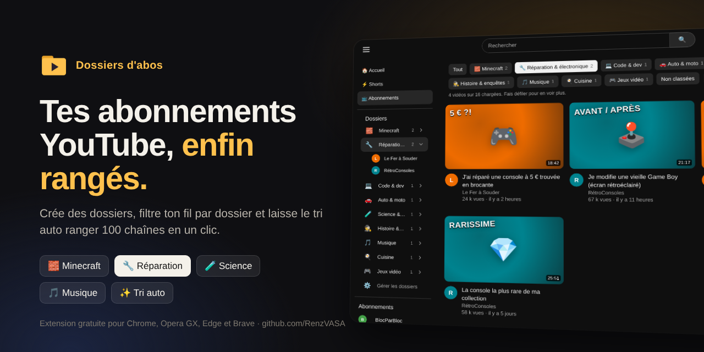
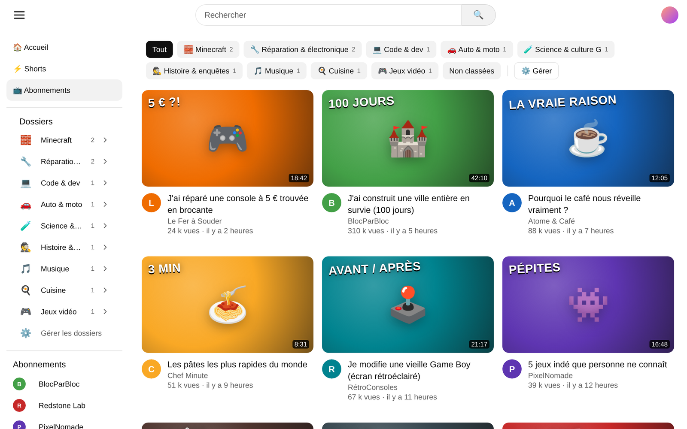
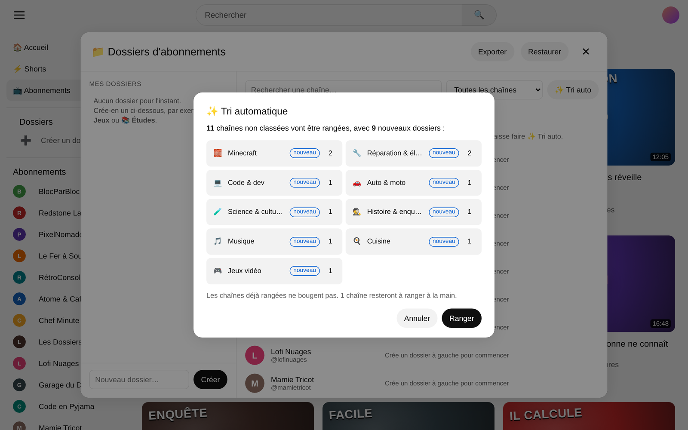
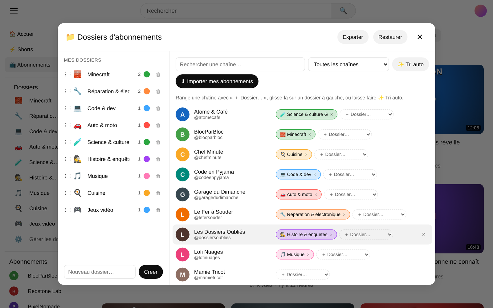
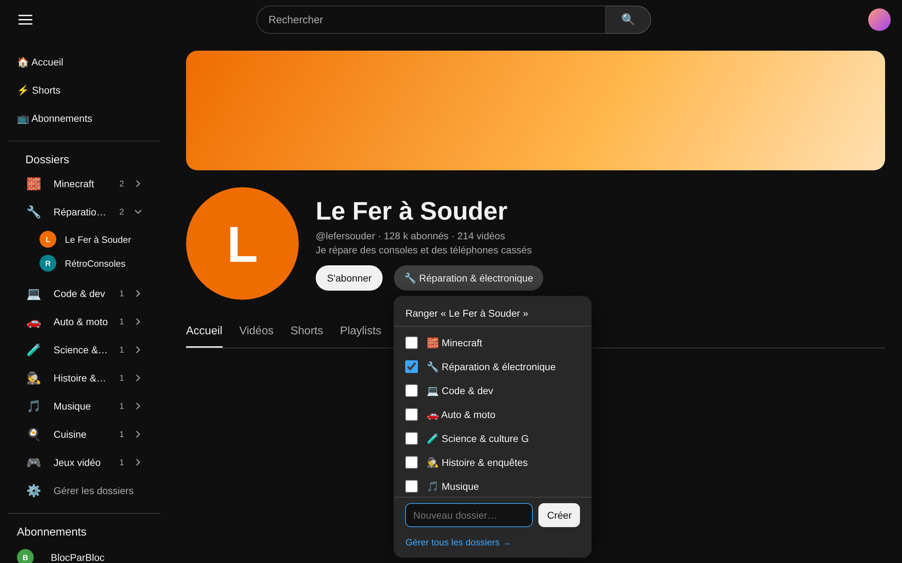

<p align="center">
  
</p>

<p align="center">
  <b>Range tes abonnements YouTube dans des dossiers et filtre ton fil Abonnements par dossier.</b><br>
  Extension gratuite et open source pour Chrome, Opera GX, Edge et Brave.
</p>

<p align="center">
  <a href="https://github.com/RenzVASA/dossiers-abos-youtube/releases/latest"><b>⬇ Télécharger</b></a> ·
  <a href="https://renzvasa.github.io/dossiers-abos-youtube/">🌐 Site</a> ·
  <a href="#-installation">📦 Installation</a> ·
  <a href="#-faq">❓ FAQ</a>
</p>

---

## ✨ Fonctions

| | |
|---|---|
| 📁 **Un fil par dossier** : des onglets en haut de la page Abonnements pour ne voir que les vidéos d'un dossier |  |
| ✨ **Tri automatique** : importe tes abonnements, clique, et tes chaînes sont rangées dans des dossiers selon leur nom et leur description |  |
| 🗂️ **Gestionnaire** : recherche, glisser-déposer, emojis, couleurs, réorganisation, export et restauration |  |
| 📌 **Ranger en un clic** : un bouton à côté de « S'abonner », sur chaque chaîne et sous chaque vidéo |  |

Et aussi :
- une section **Dossiers** dans la barre latérale de YouTube ;
- un onglet **Non classées** pour repérer les chaînes oubliées ;
- le **mode clair et le mode sombre**, détectés automatiquement ;
- **100 % local** : aucun compte, aucun serveur, aucune pub. Tes vrais abonnements ne sont jamais modifiés.

## 📦 Installation

L'extension n'est pas encore sur le Chrome Web Store. On l'installe en mode développeur, ça prend une minute.

1. Télécharge `dossiers-abos-youtube-v1.2.0.zip` depuis la page [Releases](https://github.com/RenzVASA/dossiers-abos-youtube/releases/latest), puis dézippe-le dans un dossier où il restera.
2. Ouvre la page des extensions :
   - Opera GX : `opera://extensions`
   - Chrome : `chrome://extensions`
   - Edge : `edge://extensions`
3. Active le **Mode développeur** (en haut à droite).
4. Clique sur **Charger l'extension non empaquetée** et choisis le dossier dézippé.
5. Va sur YouTube, ouvre tes **Abonnements**, puis :
   1. clique sur **➕ Créer des dossiers** ;
   2. clique sur **⬇ Importer mes abonnements** (l'extension fait défiler ta liste toute seule) ;
   3. clique sur **✨ Tri auto**.

## 🛠️ Personnaliser le tri auto

Les dossiers proposés et les mots-clés se trouvent dans [`extension/presets.js`](extension/presets.js). Chaque règle associe un dossier à une expression régulière testée sur le nom et la description de la chaîne. La première règle qui correspond l'emporte.

```js
['Cuisine', /cuisine|recette|cooking|p[âa]tisserie|food/i],
```

Recharge l'extension après modification.

## ❓ FAQ

**Est-ce que ça modifie mes abonnements ?**
Non. L'extension ajoute seulement une couche de rangement par-dessus, dans ton navigateur.

**Mes dossiers sont-ils synchronisés entre mes appareils ?**
Pas automatiquement. Utilise **Exporter** dans le gestionnaire, puis **Restaurer** sur l'autre navigateur.

**Pourquoi un dossier n'affiche que quelques vidéos ?**
YouTube charge le fil petit à petit. Fais défiler la page pour en charger d'autres.

**Un bouton a disparu après une mise à jour de YouTube.**
YouTube modifie régulièrement son site. Tes dossiers restent sauvegardés. [Ouvre un ticket](https://github.com/RenzVASA/dossiers-abos-youtube/issues) avec une capture d'écran.

## 🗂️ Structure du projet

```
extension/        l'extension (à charger dans le navigateur)
  manifest.json   configuration (Manifest V3, permission : storage)
  content.js      tout ce qui s'affiche dans YouTube
  presets.js      dossiers et règles du tri auto
  popup.html/js   la fenêtre de l'icône d'extension
docs/             le mini-site (GitHub Pages) et les visuels
```

## 🔒 Vie privée

L'extension ne demande qu'une seule permission, `storage`, et ne fonctionne que sur `youtube.com`. Elle n'envoie aucune donnée nulle part : tout est enregistré dans le stockage local de ton navigateur.

## 📄 Licence

[MIT](LICENSE). Projet indépendant, non affilié à YouTube ni à Google.

---

<p align="center">Vibe codée par <a href="https://github.com/RenzVASA">RenzVASA</a>, avec l'aide de Claude, l'IA d'Anthropic.</p>
